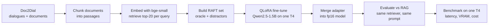
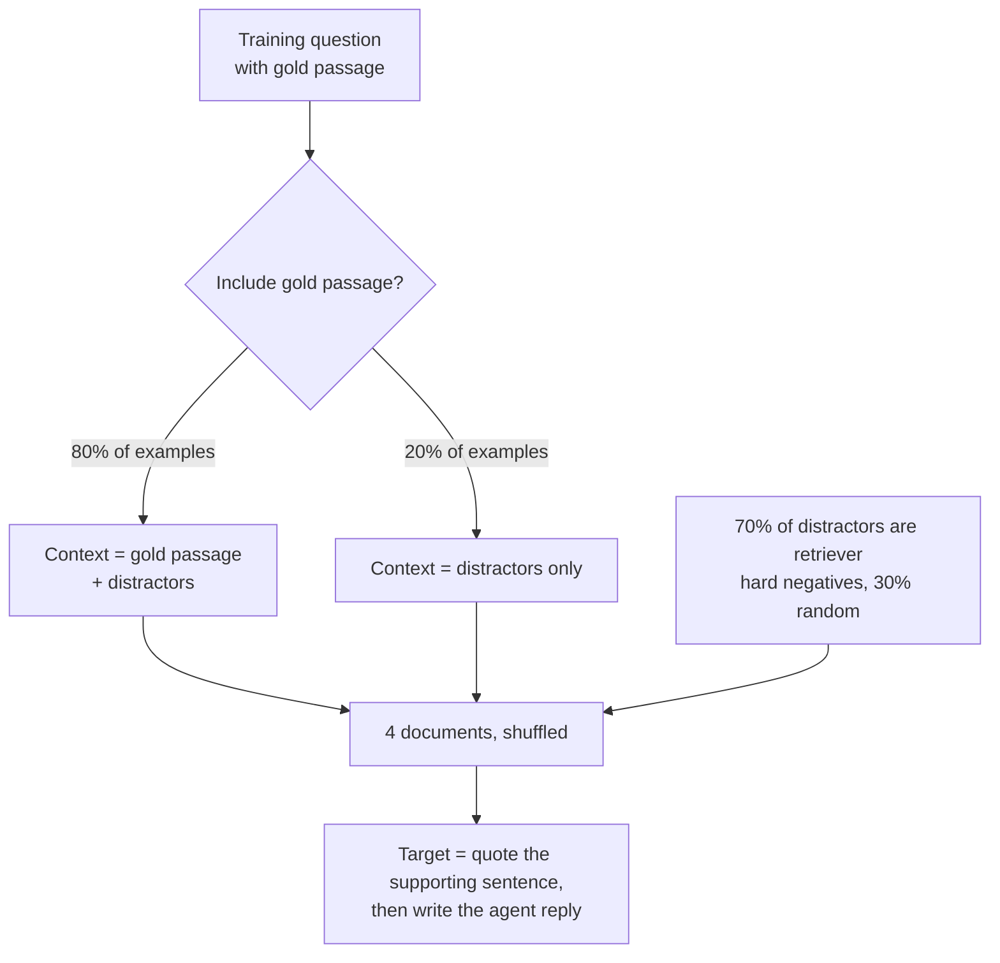
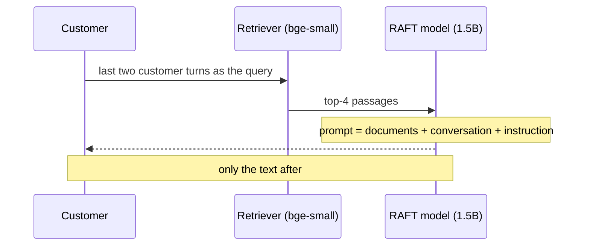

---
language:
- en
license: apache-2.0
base_model: Qwen/Qwen2.5-1.5B-Instruct
datasets:
- IBM/doc2dial
library_name: transformers
pipeline_tag: text-generation
tags:
- raft
- retrieval-augmented-fine-tuning
- rag
- retrieval-augmented-generation
- customer-support
- document-grounded-dialogue
- doc2dial
- qwen2.5
- qlora
- peft
- lora
- small-language-model
- vllm
- single-gpu
- tesla-t4
---

<h1 align="center">RAFT vs RAG on a Single T4</h1>

<p align="center">
  <b>A 1.5B customer-support model fine-tuned with Retrieval-Augmented Fine-Tuning,<br>
  independently benchmarked against plain RAG on accuracy, latency, memory and cost.</b>
</p>

<p align="center">
  
  
  
  
  
</p>

<p align="center">
  <a href="#summary">Summary</a> &nbsp;|&nbsp;
  <a href="#how-it-works">How it works</a> &nbsp;|&nbsp;
  <a href="#usage">Usage</a> &nbsp;|&nbsp;
  <a href="#experimental-setup">Setup</a> &nbsp;|&nbsp;
  <a href="#results">Results</a> &nbsp;|&nbsp;
  <a href="#findings">Findings</a> &nbsp;|&nbsp;
  <a href="#limitations">Limitations</a> &nbsp;|&nbsp;
  <a href="#reproduce">Reproduce</a>
</p>

---

## Summary

This repository contains a **merged fp16 model** (repository root) and its **LoRA adapter** (`adapter/`), trained with **RAFT** (Retrieval-Augmented Fine-Tuning, Zhang et al., 2024) on **Doc2Dial**, a corpus of customer-support dialogues grounded in real government service documents (Social Security, Veterans Affairs, DMV, Student Aid).

The project asks one question: **on hardware anyone can rent (one 16 GB Tesla T4), does fine-tuning a small model for retrieval-augmented answering beat simply giving the same documents to an off-the-shelf model?**

The answer from this study is nuanced, and it is reported in full below:

| Question | Result |
|---|---|
| Does RAFT make answers match human support agents better? | **Yes, by a wide margin.** Token F1 0.339 vs 0.230 for the same-size base model (top-4 retrieval, seen documents). Confidence intervals do not overlap. |
| Does that gain carry over to documents never seen in training? | **Yes.** 0.313 vs 0.217 on held-out documents. |
| Is RAFT more *correct* according to an LLM judge? | **No, not under realistic retrieval.** Judge score (0 to 2): RAFT 1.07, base 1.29, 7B + RAG 1.38. |
| Is it cheaper to serve? | **Yes.** About 2.9x cheaper per 1,000 queries than a 7B model with RAG, and no slower than the plain 1.5B model. |
| What limits every system? | **Retrieval.** The correct passage is in the top 4 results only about one time in three. |

> RAFT here is a **style, grounding and cost win, not an accuracy win**. The word-overlap gain comes largely from copying wording out of the retrieved text, which closely mirrors how Doc2Dial's human agents reply. When retrieval returns the wrong passage, the model quotes it and answers confidently anyway.

Not affiliated with or endorsed by any company. This is an independent research and portfolio project.

---

## How it works

### End-to-end pipeline



### What RAFT changes about training

Plain RAG hands the model retrieved documents it has never practised using. RAFT trains the model on exactly that situation: a stack of documents in which the useful one may be buried among distractors, or missing altogether.



The target text teaches a fixed output shape: quote first, then answer.

```text
##Reason: The relevant text says ##begin_quote## <supporting span from the document> ##end_quote##.
##Answer: <the support agent's reply>
```

No teacher LLM was used. Doc2Dial supplies both the human agent's reply and the exact grounding spans, so the quote-then-answer targets are built directly from gold annotations.

### Inference flow



---

## Model details

| | |
|---|---|
| **Base model** | `Qwen/Qwen2.5-1.5B-Instruct` |
| **Method** | RAFT, trained with QLoRA (4-bit NF4 base, LoRA adapters on all linear layers) |
| **Repository contents** | merged fp16 weights at the root; LoRA adapter in `adapter/`; `train_report.json` with the logged training run |
| **Language** | English |
| **Domain** | Government-service customer support (Social Security, Veterans Affairs, DMV, Student Aid) |
| **Output format** | `##Reason: ... ##begin_quote## ... ##end_quote##` then `##Answer: ...` |
| **Intended hardware** | One 16 GB GPU. Peak measured VRAM at batch size 1 is about 3.0 GB in fp16 including the retriever |

### Training recipe

Defaults used by the training notebook (the exact values of the run are logged in `train_report.json`).

| Setting | Value |
|---|---|
| Training examples | 8,000 RAFT examples (200 for validation) |
| Context per example | 4 passages (up to 2 gold, rest distractors) |
| Gold passage included | 80% of examples |
| Distractors | 70% retriever hard negatives from the top 10, 30% random |
| Quantisation | 4-bit NF4, double quantisation, fp16 compute (T4 has no bf16) |
| LoRA | rank 32, alpha 64, dropout 0.05, all linear layers |
| Optimiser | paged 8-bit AdamW, cosine schedule, learning rate 2e-4 |
| Sequence length | 2,048 tokens, examples longer than 1,900 tokens dropped |
| Loss | completion only (the agent reply and its quote), not the prompt |
| Precision and memory | fp16 autocast, gradient checkpointing |
| Library versions | `trl==0.24.0`, `transformers>=4.56.1,<5`, `peft`, `bitsandbytes` |

The adapter was merged into the **fp16** base model. QLoRA trains against a 4-bit base, so the merged model carries a small quantisation mismatch. All evaluation and benchmarking used the merged fp16 model.

---

## Usage

The model expects the prompt format it was trained on. Using a different format will degrade results.

```python
import torch
from transformers import AutoTokenizer, AutoModelForCausalLM

repo = "S-ABISHEAK/raft-qwen2.5-1.5b-doc2dial"
tok = AutoTokenizer.from_pretrained(repo)
model = AutoModelForCausalLM.from_pretrained(repo, torch_dtype=torch.float16, device_map="auto")

SYSTEM = (
    "You are a customer-support agent. Use the reference documents to answer the "
    "customer's last message. Be accurate and concise, and do not invent policies "
    "or numbers. If the documents do not contain the answer, say so."
)
INSTRUCTION = (
    "Write the agent's next reply. First copy the sentences you rely on between "
    "##begin_quote## and ##end_quote##, then write the reply after ##Answer:"
)

def build_messages(history, passages):
    """history: [{"role": "user" | "agent", "text": str}]
       passages: [{"title": str, "section": str, "text": str}]"""
    docs = "\n\n".join(
        f"[{i+1}] {p['title']}" + (f" - {p['section']}" if p.get("section") else "") + f"\n{p['text']}"
        for i, p in enumerate(passages)
    )
    convo = "\n".join(
        f"{'Customer' if t['role'] == 'user' else 'Agent'}: {t['text']}" for t in history
    )
    user = f"Reference documents:\n{docs}\n\nConversation so far:\n{convo}\n\n{INSTRUCTION}"
    return [{"role": "system", "content": SYSTEM}, {"role": "user", "content": user}]

def answer(history, passages, max_new_tokens=384):
    prompt = tok.apply_chat_template(build_messages(history, passages), tokenize=False, add_generation_prompt=True)
    ids = tok(prompt, return_tensors="pt").to(model.device)
    out = model.generate(**ids, max_new_tokens=max_new_tokens, do_sample=False)
    raw = tok.decode(out[0][ids["input_ids"].shape[1]:], skip_special_tokens=True)
    reply = raw.rsplit("##Answer:", 1)[1].strip() if "##Answer:" in raw else raw.strip()
    return reply, raw          # show `reply` to the customer, log `raw` for auditing
```

Use greedy decoding (as evaluated). To serve with vLLM on a T4, load the merged model in half precision: `LLM(model=repo, dtype="half", max_model_len=4096)`.

To use only the adapter on top of the base model:

```python
from peft import PeftModel
base = AutoModelForCausalLM.from_pretrained("Qwen/Qwen2.5-1.5B-Instruct", torch_dtype=torch.float16, device_map="auto")
model = PeftModel.from_pretrained(base, "S-ABISHEAK/raft-qwen2.5-1.5b-doc2dial", subfolder="adapter")
```

---

## Experimental setup

### Data

| Split | Size | Description |
|---|---|---|
| `train` | 8,000 | Agent turns from Doc2Dial train dialogues on seen documents |
| `valid` | 200 | Held-out dialogues from the same pool |
| `test_seen` | 500 | Doc2Dial validation dialogues on documents the model trained on |
| `test_unseen` | 300 | Dialogues on **10% of documents held out entirely from training** |

Each example is one grounded agent turn: up to four previous turns, the human agent's reply as the reference, and the gold passage ids. The retrieval query is the customer's last two turns. Splits are generated from a fixed seed (42).

The unseen-document set separates *learning a skill* (using documents well) from *memorising a corpus*. If RAFT only memorised, its advantage would vanish there.

### Systems compared

All systems use the **same retriever, same top-k, same retrieval query and greedy decoding**. Base models receive a plain prompt; RAFT receives the prompt it was trained on.

| Tag | Model | Notes |
|---|---|---|
| `base` | Qwen2.5-1.5B-Instruct + RAG | Same size as the RAFT model: isolates the effect of RAFT |
| `raft_cot` | This model + RAG | Quote-then-answer |
| `qwen3b` | Qwen2.5-3B-Instruct + RAG | fp16, middle rung of a size ladder |
| `qwen7b_awq` | Qwen2.5-7B-Instruct (4-bit AWQ) + RAG | "Bigger model plus RAG" comparison |

Reference points for the 1.5B pair: **closed-book** (no documents, the floor), **oracle** (only the gold passage, the ceiling), and top-2, top-4 and top-8 retrieval.

### Metrics

| Metric | Meaning |
|---|---|
| **Token F1** (95% bootstrap CI) | Word overlap with the human agent's reply |
| **ROUGE-L** | Longest-common-subsequence overlap |
| **Judge (0 to 2)** | Qwen2.5-7B-Instruct-AWQ rates meaning against the reference reply: 0 wrong, 1 partly right, 2 correct. First 150 queries per run |
| **Grounded** | Share of the answer's content words that appear in the supplied context (a hallucination proxy) |
| **Quote ok** | Share of quoted spans that really occur in the supplied context (RAFT only) |
| **Gold in ctx** | Share of queries where the correct passage was actually retrieved |
| **p50 / p95 latency** | End-to-end, including live retrieval, one query at a time, 200 queries |
| **Cost per 1,000 queries** | From batched throughput, at an assumed $0.35 per T4 GPU-hour |

Retriever: `BAAI/bge-small-en-v1.5`, dense brute-force search over the whole corpus, with no knowledge of which document a dialogue is about.

---

## Results

### Retrieval quality (the ceiling for every system)

| Split | recall@1 | recall@2 | recall@4 | recall@8 | recall@20 | MRR | Top-1 in correct doc |
|---|---:|---:|---:|---:|---:|---:|---:|
| test_seen | 0.074 | 0.212 | **0.350** | 0.462 | 0.562 | 0.210 | 0.436 |
| test_unseen | 0.120 | 0.227 | **0.313** | 0.407 | 0.573 | 0.228 | 0.460 |

Recall is strict: it counts only the exact gold section, so it understates cases where another passage also contains the answer.

### Answer quality at top-4 retrieval

**Seen documents (n = 500)**

| Model | Token F1 [95% CI] | ROUGE-L | Judge (0-2) | Grounded | Quote ok |
|---|---|---:|---:|---:|---:|
| Qwen2.5-1.5B + RAG (`base`) | 0.230 [0.216, 0.246] | 0.189 | 1.287 | 0.486 | - |
| Qwen2.5-3B + RAG | 0.247 [0.234, 0.262] | 0.200 | 1.293 | 0.532 | - |
| Qwen2.5-7B AWQ + RAG | 0.242 [0.227, 0.258] | 0.198 | **1.380** | 0.514 | - |
| **RAFT 1.5B** (this model) | **0.339** [0.314, 0.364] | **0.308** | 1.067 | **0.711** | 0.772 |

**Unseen documents (n = 300)**

| Model | Token F1 [95% CI] | ROUGE-L | Judge (0-2) | Grounded | Quote ok |
|---|---|---:|---:|---:|---:|
| Qwen2.5-1.5B + RAG (`base`) | 0.217 [0.200, 0.234] | 0.176 | 1.267 | 0.458 | - |
| Qwen2.5-3B + RAG | 0.234 [0.218, 0.251] | 0.188 | 1.307 | 0.506 | - |
| Qwen2.5-7B AWQ + RAG | 0.224 [0.207, 0.243] | 0.178 | **1.407** | 0.498 | - |
| **RAFT 1.5B** (this model) | **0.313** [0.283, 0.344] | **0.286** | 1.007 | **0.683** | 0.733 |

### F1 across context conditions (1.5B base vs RAFT)


<details>
<summary><b>Full numbers: token F1 / judge score by context</b></summary>

| Split | Context | Base F1 | RAFT F1 | Base judge | RAFT judge | RAFT quote ok |
|---|---|---:|---:|---:|---:|---:|
| seen | closed-book | 0.181 | 0.238 | 1.100 | 0.813 | - |
| seen | top-2 | 0.214 | 0.301 | 1.260 | 1.073 | 0.670 |
| seen | top-4 | 0.230 | 0.339 | 1.287 | 1.067 | 0.772 |
| seen | top-8 | 0.234 | 0.354 | 1.307 | 1.180 | 0.826 |
| seen | oracle | 0.308 | 0.586 | 1.660 | 1.720 | 0.952 |
| unseen | closed-book | 0.178 | 0.218 | 1.120 | 0.813 | - |
| unseen | top-2 | 0.209 | 0.302 | 1.213 | 1.013 | 0.643 |
| unseen | top-4 | 0.217 | 0.313 | 1.267 | 1.007 | 0.733 |
| unseen | top-8 | 0.226 | 0.334 | 1.273 | 1.087 | 0.799 |
| unseen | oracle | 0.288 | 0.559 | 1.553 | 1.547 | 0.950 |

</details>

### Serving cost on one Tesla T4

200 test queries, live retrieval included, vLLM in fp16, one query at a time for latency and all queries batched for throughput.

| Model | p50 latency | p95 latency | Throughput | Cost per 1,000 queries | Peak VRAM (HF, batch 1) |
|---|---:|---:|---:|---:|---:|
| Qwen2.5-1.5B + RAG | 1,459 ms | 3,081 ms | 16.6 q/s | $0.0059 | 3.02 GB |
| **RAFT 1.5B** | **1,424 ms** | **2,701 ms** | **19.6 q/s** | **$0.0050** | 3.02 GB |
| Qwen2.5-3B + RAG | not reported | not reported | 12.3 q/s | $0.0079 | 5.91 GB |
| Qwen2.5-7B AWQ + RAG | 2,119 ms | 3,527 ms | 6.7 q/s | $0.0145 | not measured |

Notes on these numbers:

- **The 3B latency is excluded.** The vLLM run reported a p50 of 5,499 ms, but the same model measured 2,564 ms through Hugging Face, and the 7B measured 2,119 ms. vLLM should not be slower than Hugging Face here, so this measurement is treated as faulty pending a re-run. Throughput and cost for the 3B come from the same run and may be affected by whatever distorted the latency, so treat them as provisional.
- **Run-to-run variation is real.** Two separate benchmark runs gave base p50 values of 1,589 ms and 1,459 ms. RAFT was slightly faster than base in both runs (1,504 ms and 1,424 ms), but the gap is within the same range as the variation between runs. Treat RAFT and base latency as roughly equal.
- **Peak VRAM** comes from the Hugging Face path (vLLM pre-allocates its cache, so its figure would be meaningless). It includes the retriever.
- **Cost** assumes $0.35 per T4 GPU-hour, an input you should replace with your provider's price. Costs scale linearly with it, and relative ratios hold.

---

## Findings

**1. RAFT strongly improves agreement with human agents, and the effect generalises.**
Token F1 rises from 0.230 to 0.339 on seen documents and from 0.217 to 0.313 on unseen documents, with non-overlapping confidence intervals. The advantage is almost the same on documents the model never trained on, so it learned *how to use documents*, not just their content. Closed-book F1 also rises slightly (0.181 to 0.238), and the seen-versus-unseen closed-book gap (0.238 vs 0.218) hints at a small amount of memorised domain knowledge.

**2. The LLM judge disagrees: RAFT is not more correct under realistic retrieval.**
At top-4, the judge scores RAFT 1.07 against 1.29 for the same-size base model and 1.38 for the 7B model. Only when the gold passage is supplied (oracle) does RAFT match or exceed base (1.72 vs 1.66 on seen documents). The F1 gain therefore reflects style and extraction: Doc2Dial agent replies often reuse document wording, and RAFT was trained to quote then answer. Word overlap rewards that heavily, while a meaning-level judge does not.

**3. Retrieval, not the generator, is the bottleneck.**
The correct passage is in the top 4 results only 35% (seen) and 31% (unseen) of the time. With the gold passage supplied, RAFT's F1 reaches 0.586. With realistic retrieval it reaches 0.339. Doc2Dial questions are short and depend on dialogue history ("What if I need help?"), and the retriever searches the whole corpus without knowing which document or product the conversation is about. Top-1 lands in the right document only about 44% of the time.

**4. When the wrong passage is retrieved, RAFT fails confidently and in the right shape.**
Inspecting outputs shows RAFT quoting an irrelevant but real passage and answering from it, for example giving a phone number with the correct formatting and hours but belonging to a different document. Token F1 still awards partial credit for the matching format, which is exactly how a metric can say "better" while a customer would call the wrong number. The base model fails differently: fluent, plausible text from general knowledge that invents programmes or rules not in the documents.

**5. RAFT's quotes are usually real but not always relevant, and sometimes absent from the context.**
The quote-ok rate is 0.77 at top-4 (0.95 with the gold passage supplied). Roughly one quote in four at top-4 does not appear in the supplied documents. This follows from training on examples where the gold passage was deliberately removed but the target still quoted it.

**6. Neither model abstains.**
The system prompt tells the model to say so when the documents do not contain the answer. Neither the base model nor RAFT does this reliably. RAFT was never trained with "I cannot find this" targets, and in closed-book mode it scores below the base model on the judge (0.81 vs 1.10), because it answers confidently with nothing to ground it.

**7. RAFT is the cheapest option to serve, and the saving against a larger model is substantial.**
A 1.5B model with RAFT costs about **2.9 times less per 1,000 queries than a 7B 4-bit model with RAG** ($0.0050 vs $0.0145) and sustains about three times the throughput. It uses about 3 GB of VRAM including the retriever. It is also no slower than the plain 1.5B model, which is consistent with its slightly shorter outputs (63 tokens vs 70 on average).

**8. Scale helps the judge, modestly.**
On the judge, 1.5B, 3B and 7B base models score 1.29, 1.29 and 1.38 on seen documents. Doubling or quadrupling model size gives a smaller gain than fixing retrieval would.

**Bottom line.** RAFT on a small model is an effective way to make a cheap model behave like a grounded support agent and to cut serving cost sharply. By itself it does not make answers more correct when retrieval is weak. The most valuable next step is better retrieval, not a larger generator.

---

## Limitations

- **Domain.** Doc2Dial covers US government services. Results may not transfer to insurance, telecom or banking support.
- **Judge reliability.** The LLM judge is one model (Qwen2.5-7B-Instruct AWQ) scoring only the first 150 queries per run against a single reference reply. No confidence interval was computed. Treat judge differences as strong indications, not proofs. A small human spot-check was not performed.
- **Metric bias.** Token F1 and ROUGE-L reward copying document wording, which favours extractive systems like RAFT.
- **Single run.** One training run, one seed, one benchmark of 200 queries per configuration (two for the 1.5B pair). No variance across seeds.
- **Retrieval is deliberately unscoped.** The retriever searched the entire corpus without knowing the document or domain. A deployed system usually knows the product or page, which would raise recall for every model.
- **Cost assumption.** The $0.35 per GPU-hour price is an assumption, not a quote.
- **Merged-model mismatch.** The adapter trained against a 4-bit base but was merged into fp16.
- **3B latency** is not reported because the measurement looked faulty.
- **Single reference.** Each question has one human reply, so valid alternative answers are penalised by overlap metrics.

### Intended use and out-of-scope use

Intended for research, education and benchmarking of RAFT versus RAG on constrained hardware.

**Not suitable for giving real customers factual, legal, financial or benefits advice.** The model can quote irrelevant passages confidently and does not reliably refuse when documents lack the answer. Any real deployment would need better retrieval, abstention handling and human review.

---

## Reproduce

The full pipeline runs on Kaggle (T4 GPU) in three notebooks, one session at a time, passing results through saved outputs and this repository.

| Notebook | Purpose | Accelerator |
|---|---|---|
| `1_data_and_raft_build` | Download Doc2Dial, build passages, splits, retrieval index and the RAFT dataset | None needed |
| `2_train_qlora_raft` | QLoRA fine-tuning with checkpoint resume, then adapter merge | GPU T4 |
| `3_eval_bench_report` | Evaluate all systems, LLM-judge, benchmark latency and cost, build the report | GPU T4 |

Code: <https://github.com/S-ABISHEAK> (project repository containing the three notebooks and the result tables).

---

## Roadmap

- Retrieval scoped to the known document or domain, plus hybrid keyword and dense search with a reranker.
- Abstention training: add "the documents do not contain this" targets to the examples without the gold passage.
- A RAFT run on the 3B model and an answer-only (no quote) ablation.
- A larger human-checked evaluation to validate the LLM judge.
- Re-measure 3B serving latency.

---

## Citation and acknowledgements

```bibtex
@misc{abisheak2026raftvsrag,
  title  = {RAFT vs RAG on a Single T4: Fine-tuning a 1.5B Customer-Support Model on Doc2Dial},
  author = {Abisheak},
  year   = {2026},
  url    = {https://huggingface.co/S-ABISHEAK/raft-qwen2.5-1.5b-doc2dial}
}
```

Built on prior work:

- **RAFT: Adapting Language Model to Domain Specific RAG**, Zhang et al., 2024 (arXiv:2403.10131)
- **Doc2Dial: A Goal-Oriented Document-Grounded Dialogue Dataset**, Feng et al., EMNLP 2020 (arXiv:2011.06623). The dataset is released under CC BY 3.0; attribution is required.
- **Qwen2.5 Technical Report**, Qwen Team, 2024 (arXiv:2412.15115). Base model `Qwen/Qwen2.5-1.5B-Instruct`, Apache 2.0.
- **QLoRA: Efficient Finetuning of Quantized LLMs**, Dettmers et al., 2023 (arXiv:2305.14314)
- **C-Pack: Packaged Resources to Advance General Chinese Embedding** (BGE embeddings), Xiao et al., 2023 (arXiv:2309.07597)
- **Efficient Memory Management for LLM Serving with PagedAttention** (vLLM), Kwon et al., 2023 (arXiv:2309.06180)
